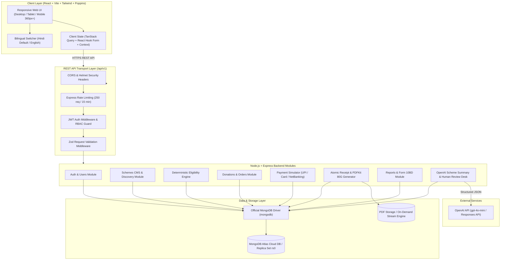
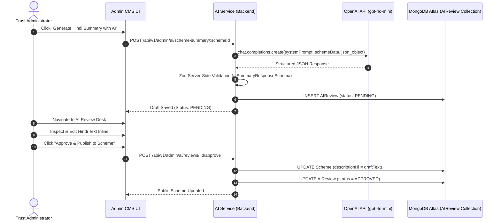

# UdaanHer: Giving women wings to fly — System Architecture Document

## 1. Executive Architecture Overview

**UdaanHer** ("Giving women wings to fly" / उड़ानहर: महिलाओं को उड़ने के पंख) is architected as a robust, high-integrity modular monolith. The system bridges rural and semi-urban women in Madhya Pradesh to government welfare schemes while providing a modern, auditable donation platform for Company A, a registered charitable trust in Bhopal.



---

## 2. Layer Separation & Design Principles

### 2.1 Route Handler vs Business Logic Separation

Every backend module strictly separates responsibilities:

1. **Routes Layer (`*.routes.ts`)**: Defines URI paths, HTTP methods, and attaches validation & authorization middleware chains.
2. **Controller Layer (`*.controller.ts`)**: Unpacks request payloads, delegates business execution to the service layer, and shapes the standard API JSON envelope.
3. **Service Layer (`*.service.ts`)**: Contains all pure business logic, database transactions, concurrency controls, and calculations. No HTTP response manipulation occurs here.
4. **Data Access Layer (`MongoClient`)**: Parameterized document access on MongoDB Atlas, transactional rollback safety, and constraint enforcement.

### 2.2 Standard API Envelope Format

All API responses adhere to a consistent contract:

- **Success Response**:
  ```json
  {
    "success": true,
    "data": { ... },
    "message": "Operation completed successfully"
  }
  ```
- **Error Response**:
  ```json
  {
    "success": false,
    "error": {
      "code": "VALIDATION_ERROR",
      "message": "Invalid request",
      "details": [
        {
          "field": "donorPAN",
          "message": "Please enter a valid 10-character Indian PAN"
        }
      ]
    }
  }
  ```

---

## 3. High-Concurrency Financial Safety Architecture on MongoDB Atlas

### 3.1 Concurrency-Safe Receipt Numbering

Section 10 strictly forbids generating receipt numbers via `COUNT(*)`, in-memory variables, or unlocked max values. UdaanHer uses **MongoDB multi-document replica set transactions** and atomic sequence increments:

```typescript
// Atomically allocate next sequential receipt number per Financial Year
const seq = await tx.receiptSequence.upsert({
  where: { financialYear },
  update: {
    nextNumber: { increment: 1 },
  },
  create: {
    financialYear,
    nextNumber: 1,
  },
});
```

Format: `UDAAN/80G/{YYYY-YY}/{000001}` (e.g., `UDAAN/80G/2026-27/000001`).

### 3.2 Optimistic Concurrency & Transaction Retry Strategy

In high-throughput environments, concurrent operations on shared MongoDB documents can trigger transient write conflicts (`P2034`). UdaanHer wraps payment finalization in a dedicated retry wrapper (`server/src/utils/transaction-retry.ts`):

1. **Exponential Backoff with Jitter**: Automatically retries transient conflicts up to 5 times.
2. **Idempotency Gate**: If the donation was already finalized by a concurrent request, the existing confirmed donation and receipt are returned immediately without allocating a new sequence number.
3. **Zero Failure Receipts**: Failed transactions update the status to `FAILED` and **never allocate a receipt or increment sequence numbers**.

---

## 4. Artificial Intelligence (AI) Integration Architecture

The AI module (`server/src/modules/ai/`) handles the synthesis of complex official government welfare scheme texts into simple, grassroots Hindi:



### Safety and Guardrails:

- **Zero Hallucination Rules**: Explicit system prompt instructs the LLM never to invent financial grants, ages, or dates.
- **Human-in-the-Loop Workflow**: Drafts are created in `PENDING` state and **never published automatically**.
- **Server-Side Isolation**: The frontend never communicates with OpenAI directly; API keys are never exposed to browsers.
- **Graceful Fallback**: If `OPENAI_API_KEY` is not present, the service produces an accurate structured template draft with zero crashes.

---

## 5. Security & Data Protection Architecture

1. **DPDP Act 2023 Principles**: Data minimization is enforced. Only required fields for 80G tax receipting (Name, Email, Phone, PAN, Address) are stored.
2. **PAN Masking**: Donor PANs are stored securely in MongoDB Atlas for 80G and Form 10BD compliance, but all user-facing listings, APIs, and logs mask the middle digits (e.g. `AB******4F`).
3. **FCRA Contribution Block**: Non-Indian cards and international contributions are actively blocked at both validation and gateway simulation layers with explicit explanatory messaging.
4. **Access Control**: Donors can only access their own donations and receipts. Any attempt by Donor A to access Donor B's receipt responds with `403 FORBIDDEN`.
