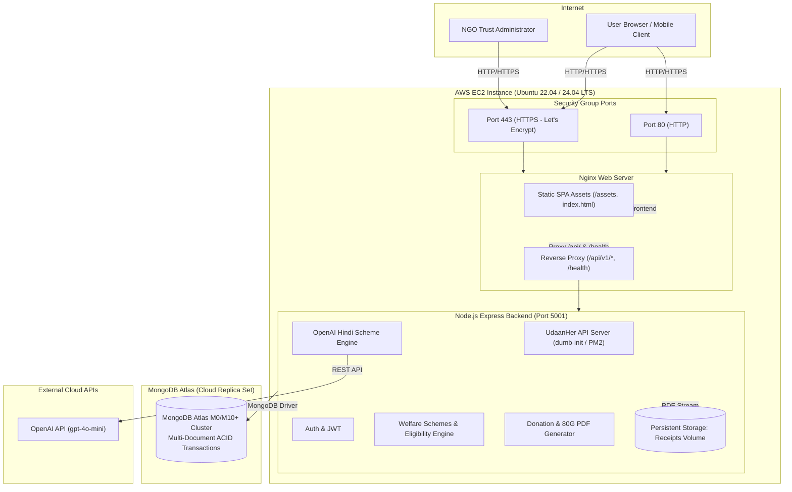

# UdaanHer: Giving women wings to fly — AWS EC2 Production Deployment Guide

This guide provides end-to-end instructions for deploying the **UdaanHer** full-stack platform onto **Amazon Web Services (AWS) Elastic Compute Cloud (EC2)**, integrated with **MongoDB Atlas** and secured with automated SSL via **Let's Encrypt**.

---

## 1. Architecture Overview



---

## 2. EC2 Instance Sizing & Prerequisites

| Resource | Free Tier / Small Scale | Production Recommendation |
|---|---|---|
| **Instance Type** | `t3.micro` or `t2.micro` (1 vCPU, 1 GB RAM) | `t3.small` or `t3.medium` (2 vCPU, 2-4 GB RAM) |
| **Operating System** | Ubuntu Server 22.04 LTS or 24.04 LTS (x86_64) | Ubuntu Server 22.04 LTS or Amazon Linux 2023 |
| **Storage (EBS)** | 20 GB gp3 SSD | 30-50 GB gp3 SSD |
| **Swap Memory** | 2 GB Swap (automatically configured by setup script) | 2 GB Swap |
| **IP Address** | AWS Elastic IP (Static IPv4) | AWS Elastic IP + Route 53 Custom Domain |

> [!IMPORTANT]
> When using `t2.micro` or `t3.micro` (1 GB RAM), compiling Vite assets and installing packages can trigger Out-Of-Memory (OOM) errors. Our setup script (`scripts/ec2-setup.sh` & `aws/ec2-user-data.sh`) automatically configures a **2 GB Swap file**, ensuring 100% stable builds on AWS free tier instances.

---

## 3. AWS Console Setup Step-by-Step

### Step 3.1: Launch the EC2 Instance
1. Open the [AWS EC2 Management Console](https://console.aws.amazon.com/ec2).
2. Click **Launch Instance**.
3. **Name**: `udaanher-production`
4. **Application and OS Images (AMI)**: Choose **Ubuntu Server 22.04 LTS (HVM), SSD Volume Type**.
5. **Instance Type**: Select `t3.micro` (Free Tier) or `t3.small`.
6. **Key Pair (login)**: Select an existing key pair or create a new one (e.g. `udaanher-key.pem`) and download it.
7. **Network Settings**:
   - Create Security Group: `udaanher-sg`
   - Inbound rules to allow:
     - **SSH** (Port 22) -> Source: `My IP` (or `0.0.0.0/0`)
     - **HTTP** (Port 80) -> Source: `Anywhere (0.0.0.0/0)`
     - **HTTPS** (Port 443) -> Source: `Anywhere (0.0.0.0/0)`
8. **Configure Storage**: Set Root volume to **20 GiB gp3**.
9. **Advanced Details (Optional Automated Bootstrap)**:
   - Scroll down to **User Data** and paste the contents of [`aws/ec2-user-data.sh`](file:///Users/mac/Desktop/UdaanHer/aws/ec2-user-data.sh).
10. Click **Launch Instance**.

### Step 3.2: Allocate and Associate an Elastic IP
1. In the EC2 Sidebar, go to **Network & Security** > **Elastic IPs**.
2. Click **Allocate Elastic IP address** > **Allocate**.
3. Select the allocated Elastic IP > **Actions** > **Associate Elastic IP address**.
4. Select your newly created `udaanher-production` instance and click **Associate**.

### Step 3.3: Whitelist Elastic IP in MongoDB Atlas
1. Sign in to [MongoDB Atlas](https://cloud.mongodb.com/).
2. In the left navigation, select **Security** > **Network Access**.
3. Click **Add IP Address**.
4. Enter your EC2 Elastic IP address (or `0.0.0.0/0` during testing) with description `AWS EC2 UdaanHer Server`.
5. Click **Confirm**.

---

## 4. Connecting to Your EC2 Instance

Open your local terminal and connect via SSH:

```bash
# Set secure permissions on your key file
chmod 400 udaanher-key.pem

# Connect to EC2
ssh -i udaanher-key.pem ubuntu@<YOUR_EC2_ELASTIC_IP>
```

---

## 5. Automated Server Bootstrap

Run the idempotent setup script to install Node.js 20 LTS, Docker, Nginx, PM2, and configure swap memory:

```bash
# Clone the repository (or transfer your codebase)
git clone https://github.com/your-org/UdaanHer.git udaanher
cd udaanher

# Run automated bootstrap
sudo ./scripts/ec2-setup.sh
```

---

## 6. Configure Environment Variables

Create `server/.env` based on the production template:

```bash
cp .env.production.example server/.env
nano server/.env
```

Configure your production parameters:
```env
NODE_ENV=production
PORT=5001
CLIENT_URL=http://<YOUR_EC2_ELASTIC_IP>,https://yourdomain.com
DATABASE_URL="mongodb+srv://<username>:<password>@cluster0.<hash>.mongodb.net/udaanher?retryWrites=true&w=majority"
JWT_SECRET=generate_with_openssl_rand_hex_32
OPENAI_API_KEY=your_openai_api_key_here
TRUST_NAME=UdaanHer Women Welfare & Empowerment Charitable Trust (Bhopal)
TRUST_ADDRESS=Plot 14, Arera Hills, Bhopal, Madhya Pradesh - 462011
TRUST_PAN=AAATC1234D
TRUST_80G_REGISTRATION=CIT(E)/BPL/80G/2021-22/A-1089
```

> [!TIP]
> Generate a cryptographically secure JWT Secret key directly on the server:
> ```bash
> openssl rand -hex 32
> ```

---

## 7. Deployment Options

### Option A: Docker Compose Deployment (Recommended)

Deploy the entire full-stack platform with a single command:

```bash
# Build containers, start services, and seed database
./scripts/deploy.sh --docker --seed
```

What this does:
1. Validates `server/.env` and MongoDB connectivity.
2. Builds the lightweight Node.js 20 backend image.
3. Compiles the React Vite frontend and bundles it into a tuned Nginx container.
4. Mounts persistent Docker volumes for 80G PDF receipts (`udaanher_receipts`).
5. Executes the MongoDB database seeder (`node dist/scripts/seed.js`).
6. Verifies container health checks.

#### Docker Useful Commands:
```bash
# View live logs
docker compose logs -f

# Check container health status
docker compose ps

# Restart services
docker compose restart

# Rebuild after code updates
./scripts/deploy.sh --docker --pull
```

---

### Option B: Native Deployment (PM2 + Host Nginx)

Ideal for resource-constrained instances (e.g. `t2.micro`):

```bash
# Build workspaces, configure Host Nginx, launch PM2, and seed database
./scripts/deploy.sh --native --seed
```

What this does:
1. Installs npm workspace dependencies.
2. Compiles TypeScript backend to `server/dist`.
3. Builds React Vite frontend to `client/dist`.
4. Deploys `/etc/nginx/sites-available/udaanher` and reloads Nginx.
5. Starts or reloads the backend process with PM2 using `ecosystem.config.cjs`.
6. Seeds initial demonstration and statutory data.

#### PM2 Useful Commands:
```bash
# Monitor process metrics (CPU/RAM)
pm2 monit

# View backend logs
pm2 logs udaanher-backend

# Restart backend
pm2 restart udaanher-backend
```

---

## 8. Custom Domain & SSL/TLS Setup (HTTPS)

Once you map a domain (e.g. `udaanher.org`) to your EC2 Elastic IP via Route 53 or your DNS registrar:

```bash
# Run one-command automated SSL setup with Let's Encrypt
sudo ./scripts/ssl-setup.sh udaanher.org admin@udaanher.org
```

This automatically:
- Obtains a 2048-bit RSA certificate from Let's Encrypt.
- Configures HTTP -> HTTPS 301 redirection.
- Configures TLS 1.2/1.3 and HSTS security headers.
- Schedules automated background renewal.

---

## 9. Automated CI/CD with GitHub Actions

The repository includes a ready-to-use GitHub Actions workflow at [`.github/workflows/deploy-ec2.yml`](file:///Users/mac/Desktop/UdaanHer/.github/workflows/deploy-ec2.yml).

### Adding GitHub Secrets:
In your GitHub Repository > **Settings** > **Secrets and variables** > **Actions**:

| Secret Name | Value |
|---|---|
| `EC2_HOST` | Your EC2 Elastic IP address (e.g. `54.210.12.34`) |
| `EC2_USER` | `ubuntu` |
| `EC2_SSH_KEY` | Contents of your private key file (`udaanher-key.pem`) |
| `EC2_PORT` | `22` (default) |

On every push to the `main` branch, GitHub Actions will:
1. Run all unit tests for server and client.
2. Verify TypeScript compilation and Vite build.
3. SSH into your EC2 instance and run `./scripts/deploy.sh --docker`.
4. Validate HTTP `/health` endpoint response.

---

## 10. Verification & Smoke Testing

After deployment, test the key endpoints:

```bash
# 1. API Health Check
curl -i http://<YOUR_EC2_IP>/health
# Expected: HTTP 200 {"status":"UP","uptime":...}

# 2. Database Connectivity Check
curl -i http://<YOUR_EC2_IP>/health/ready
# Expected: HTTP 200 {"status":"READY","database":"CONNECTED"}

# 3. Public Schemes List
curl -s http://<YOUR_EC2_IP>/api/v1/schemes | grep -o '"success":true'

# 4. Frontend Root
curl -I http://<YOUR_EC2_IP>/
# Expected: HTTP 200 OK
```

### Pre-Seeded Demonstration Accounts:
| Role | Email | Password |
|---|---|---|
| **Trust Administrator** | `admin@udaanher.org` | `Admin@123456` |
| **Donor 1 (Priya Sharma)** | `priya.sharma@example.com` | `Donor@123456` |
| **Donor 2 (Rajesh Patel)** | `rajesh.patel@example.com` | `Donor@123456` |

---

## 11. Maintenance, Backups & Troubleshooting

### Receipt Storage Persistence
All 80G tax receipts generated by the backend are stored in:
- Docker Mode: Named volume `udaanher_receipts` (located at `/var/lib/docker/volumes/udaanher_receipts/_data`).
- Native Mode: `server/storage/receipts`.

To back up receipt storage:
```bash
sudo tar -czvf udaanher_receipts_$(date +%F).tar.gz /var/lib/docker/volumes/udaanher_receipts/_data
```

### Troubleshooting Checklist:
1. **Connection Refused / Cannot Access Port 80**:
   - Check AWS EC2 Security Group: verify Inbound rule allows HTTP (Port 80) and HTTPS (Port 443) from `0.0.0.0/0`.
   - Check UFW status: `sudo ufw status`.
2. **Database Connection Timeout (`ECONNREFUSED` / `MongooseServerSelectionError`)**:
   - In MongoDB Atlas > Network Access, ensure your EC2 Elastic IP is added.
3. **Out of Memory during Build**:
   - Check swap: `free -h`. Run `sudo ./scripts/ec2-setup.sh` to ensure 2GB swap is active.
4. **Rate Limit Triggered for All Users Behind Nginx**:
   - `server/src/app.ts` is configured with `app.set('trust proxy', 1);` to correctly identify individual client IP addresses via `X-Forwarded-For`.

