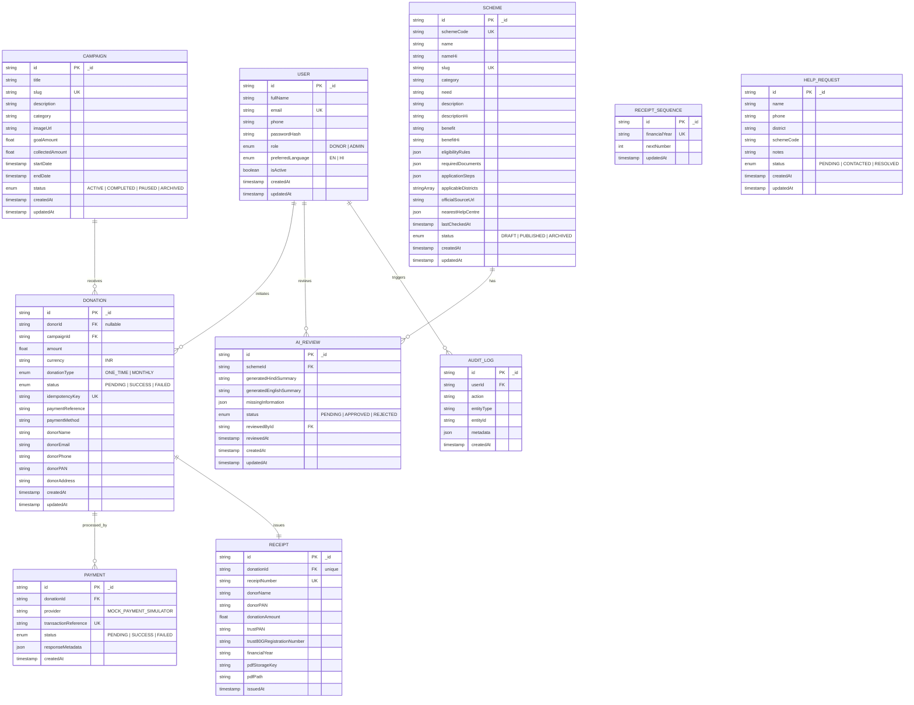

# UdaanHer: Giving women wings to fly — Database Design & Schema Reference (MongoDB Atlas)

## 1. Document Database Overview

The UdaanHer platform is powered by **MongoDB Atlas**, managed through the official native MongoDB Node.js driver (`mongodb`). Financial integrity, zero floating-point calculation errors, and strict non-destructive constraints govern all collections.

### Design Principles:

1. **Document-Based Data Modeling**: Core entities are modeled as flexible, high-performance MongoDB documents with embedded JSON sub-structures (`eligibilityRules`, `requiredDocuments`, `applicationSteps`, `nearestHelpCentre`) where appropriate for atomic reads.
2. **Multi-Document ACID Transactions**: Financial workflows (`Donation`, `Payment`, `Receipt`, and `ReceiptSequence`) execute within multi-document replica set sessions (`session.withTransaction`) with retry backoff for conflict-free atomic execution.
3. **Atomic Sequence Generation**: Receipt numbering utilizes an isolated collection (`ReceiptSequence`) using atomic `upsert` with `{ increment: 1 }`.
4. **Data Minimization & Snapshotting**: Receipts store a frozen historical snapshot of the donor's name, PAN, and trust details at the moment of issuance, ensuring receipts remain legally intact under Section 80G even if the donor later edits their profile.

---

## 2. Collection Relationship Diagram

---

## 3. Collections Specification

### 3.1 `User` Collection

- **\_id**: `String` (UUID / ObjectId string).
- **email**: `String`, Unique index.
- **role**: Enum (`DONOR`, `ADMIN`), default `DONOR`. Indexed for administrative filtering.
- **passwordHash**: `String`, 10-round bcrypt hash.
- **isActive**: `Boolean`, soft deactivation flag.

### 3.2 `Campaign` Collection

- **\_id**: `String` (UUID).
- **slug**: `String`, Unique index for SEO-friendly URLs (`/campaigns/:slug`).
- **goalAmount** & **collectedAmount**: `Float`, INR monetary values.
- **status**: Enum (`ACTIVE`, `COMPLETED`, `PAUSED`, `ARCHIVED`). Indexed.

### 3.3 `Scheme` Collection

- **schemeCode**: `String`, Unique index (e.g., `SCH-014`).
- **slug**: `String`, Unique index (`kalyani-pension-scheme`).
- **eligibilityRules**: `Json`, deterministic structured criteria matching rule engine.
- **applicableDistricts**: Array of `String`, indexed for multi-district matching.
- **status**: Enum (`DRAFT`, `PUBLISHED`, `ARCHIVED`). Compound index on `[status, category]`.

### 3.4 `Donation` Collection

- **idempotencyKey**: `String`, Unique index. Auto-generated if omitted to ensure MongoDB sparse unique integrity.
- **status**: Enum (`PENDING`, `SUCCESS`, `FAILED`).
- **donorPAN**: `String`, 10-character Indian PAN. Masked in public APIs (`AB******4F`).
- **createdAt**: `DateTime`, indexed for Form 10BD annual reporting.

### 3.5 `Receipt` Collection

- **receiptNumber**: `String`, Unique index (`UDAAN/80G/YYYY-YY/000001`).
- **financialYear**: `String`, indexed (`2026-27`).
- **donationAmount**: `Float`, frozen amount in INR.

### 3.6 `ReceiptSequence` Collection

- **financialYear**: `String`, Unique index.
- **nextNumber**: `Int`, atomically incremented via MongoDB `$inc` within a transaction.

---

## 4. Indexing Strategy on MongoDB Atlas

To guarantee millisecond query performance across high volumes of schemes and donations:

| Collection        | Indexed Fields        | Index Type    | Purpose                             |
| ----------------- | --------------------- | ------------- | ----------------------------------- |
| `User`            | `email`               | Unique        | Login lookup & duplicate prevention |
| `User`            | `role`                | Single Field  | RBAC query filtering                |
| `Campaign`        | `slug`                | Unique        | Public URL routing                  |
| `Campaign`        | `status`              | Single Field  | Active campaign discovery           |
| `Scheme`          | `slug`, `schemeCode`  | Unique        | Direct scheme lookup                |
| `Scheme`          | `status, category`    | Compound      | Filtered scheme discovery           |
| `Donation`        | `idempotencyKey`      | Unique        | Payment idempotency protection      |
| `Donation`        | `donorId, campaignId` | Single Fields | Donor portal & campaign rollups     |
| `Donation`        | `status, createdAt`   | Compound      | Form 10BD and admin reports         |
| `Receipt`         | `receiptNumber`       | Unique        | 80G verification lookup             |
| `Receipt`         | `donationId`          | Unique        | 1:1 relation with donation          |
| `Receipt`         | `financialYear`       | Single Field  | Annual statement generation         |
| `ReceiptSequence` | `financialYear`       | Unique        | Atomic sequential allocation        |
| `AIReview`        | `schemeId, status`    | Compound      | Admin review queue                  |
| `HelpRequest`     | `status, createdAt`   | Compound      | Field coordinator workflow          |
