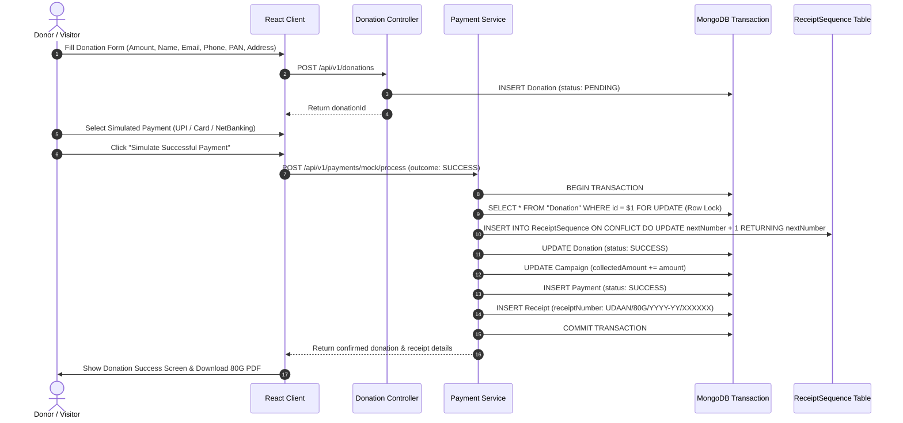

# UdaanHer: Giving women wings to fly — Comprehensive Technical Design Document

## 1. Problem Statement

Company A is a registered charitable trust in Bhopal, Madhya Pradesh, operating across nine central districts (Bhopal, Sehore, Raisen, Rajgarh, Vidisha, Hoshangabad, Harda, Betul, Guna) with 220 staff members, 1,400 volunteers, and 12,000 donors handling ₹26 crore in annual charitable contributions.

Historically, the trust operated through fragmented manual procedures:

- Donor contributions tracked in error-prone Excel spreadsheets.
- Section 80G tax exemption certificates and donation receipts generated manually in Microsoft Word documents.
- Annual Form 10BD electronic statements compiled manually, risking mismatch penalties.
- Government welfare schemes shared haphazardly via printed leaflets and WhatsApp messages.
- Women calling field workers asking if they qualify for state assistance.

**UdaanHer: Giving women wings to fly** resolves these challenges by providing a centralized, bilingual, automated web platform that connects grassroots women to government welfare schemes through a deterministic eligibility engine while delivering an audit-grade donation and concurrency-safe 80G receipting infrastructure.

---

## 2. Requirements

### 2.1 Core Build Requirements

1. **Public Scheme Discovery**: Bilingual search, filtering by category, need, and district with full scheme profiles and official portal references.
2. **Deterministic Eligibility Finder**: Multi-step questionnaire (6 questions) matching user answers against state rules with clear explanations and non-approval disclaimers.
3. **Donation Checkout Flow**: Test-mode donation engine supporting preset amounts, one-time and monthly simulation, PAN validation, and active FCRA foreign card rejection.
4. **Concurrency-Safe 80G Receipts**: Atomic sequential numbering (`UDAAN/80G/YYYY-YY/000001`) with instant downloadable PDFKit certificates and historical snapshotting.
5. **Donor Accounts & Self-Service**: Protected portal for donors to view past contributions, masked PANs, and re-download authenticated PDF receipts.
6. **Trust Administrative Suite**:
   - Executive dashboard with live database queries and Recharts analytics.
   - Scheme CMS (Draft, Published, Archived) with audit trails.
   - Campaign manager with progress tracking.
   - Form 10BD preview and one-click CSV export for electronic tax filing.
7. **AI Plain-Hindi Summary Integration**: Server-side OpenAI Node.js SDK integration with structured JSON validation and a human-in-the-loop review desk (`PENDING`, `APPROVED`, `REJECTED`).

### 2.2 Scope Restrictions (Explicitly Excluded)

- Online foreign currency contributions (FCRA processing).
- Volunteer shift management.
- Corporate CSR and grant proposal tracking.

---

## 3. Assumptions

1. **Client Identity**: "Company A - UdaanHer Women Welfare & Empowerment Charitable Trust (Bhopal)" is a demonstration charitable entity with fictional credentials (`PAN: AAATC1234D`, `80G: CIT(E)/BPL/80G/2021-22/A-1089`).
2. **Indian Financial Year**: Financial years run from April 1 to March 31. A donation in November 2026 belongs to FY `2026-27`.
3. **Legal Disclaimer**: The platform provides preliminary guidance; deterministic matching results do not constitute official government approval or legal entitlement.
4. **Simulated Payments**: Financial transactions are simulated in development/test mode without charging live credit cards or UPI accounts.

---

## 4. Architecture & Technology Decisions

| Layer              | Chosen Technology                                  | Architectural Justification                                                                                                                                                                    |
| ------------------ | -------------------------------------------------- | ---------------------------------------------------------------------------------------------------------------------------------------------------------------------------------------------- |
| **Architecture**   | Modular Monolith                                   | Single repository, decoupled client and server modules. Avoids microservice overhead, network latency, and distributed transaction complexity while keeping business boundaries crystal clear. |
| **Frontend**       | React 18/19, TypeScript, Vite                      | Fast HMR, type safety, efficient tree-shaking, minimal bundle footprint.                                                                                                                       |
| **Styling & UI**   | Tailwind CSS, Lucide React                         | Semantic design tokens adhering strictly to client palette (`#174C3C`, `#FAF9F5`, `#C77B59`). Responsive across 360px–1440px.                                                                  |
| **Backend**        | Node.js, Express.js, TypeScript                    | High-throughput asynchronous I/O, RESTful conventions, robust middleware ecosystem.                                                                                                            |
| **Database**       | Official MongoDB Driver (`mongodb`), MongoDB Atlas | High-performance document queries, collection management, multi-document ACID transaction guarantees, atomic sequence increments.                                                              |
| **PDF Engine**     | PDFKit                                             | Fast server-side vector streaming, zero external headless Chrome dependencies, lightweight memory footprint.                                                                                   |
| **AI Integration** | Official OpenAI SDK                                | Cost-efficient model (`gpt-4o-mini`), structured JSON mode, Zod validation, decoupled behind service interface with local synthesis fallback.                                                  |

---

## 5. Database Model & Relationships

The relational model is designed around nine normalized entities:

- `User`: Accounts for `DONOR` and `ADMIN` roles. Passwords hashed using `bcrypt` (10 rounds).
- `Campaign`: Welfare initiatives with goal and collected amounts (`Decimal(12, 2)`).
- `Scheme`: Official government welfare programs with JSONB eligibility criteria, required documents, and district lists.
- `Donation`: Financial contribution records linked to donor, campaign, and payment attempts.
- `Payment`: Audit log of each mock transaction attempt with response metadata.
- `Receipt`: Concurrency-safe immutable snapshot of issued 80G certificate.
- `ReceiptSequence`: Dedicated sequence counter table for Indian financial years.
- `AIReview`: Human-in-the-loop review state machine (`PENDING`, `APPROVED`, `REJECTED`).
- `AuditLog`: Immutable log of critical administrative operations.
- `HelpRequest`: Free helpline callback requests submitted by citizens.

---

## 6. Authentication & Role-Based Authorization

1. **Tokens**: Stateless JSON Web Tokens (JWT) signed with `HS256` containing `userId`, `email`, and `role`.
2. **Roles**:
   - `VISITOR`: Unauthenticated public access. Browses schemes, uses eligibility calculator, selects campaigns, initiates donations.
   - `DONOR`: Authenticated supporter. Views own contribution history, downloads own receipts, updates personal profile.
   - `ADMIN`: Trust officer. Full CMS, AI review desk, donation audit logs, Form 10BD export.
3. **Data Isolation**: Donors cannot inspect or download another donor's records. Queries filter on `donorId === authenticatedUser.id` and receipts verify ownership before streaming.

---

## 7. Deterministic Eligibility Matching Logic

Section 8 strictly dictates: **Do not let AI determine legal eligibility.**
Eligibility is evaluated deterministically in `server/src/modules/eligibility/eligibility.engine.ts`:

- **District Evaluation**: Verifies whether applicant district is in `scheme.applicableDistricts`.
- **Age Rules**: Verifies `applicantAge >= minAge && applicantAge <= maxAge`.
- **Marital Status**: Checks array inclusion (`unmarried`, `married`, `widowed`, `divorced`).
- **BPL Card Requirement**: Mandatory check if `requiresBPL === true`.
- **SHG Requirement**: Mandatory check if `requiresSHG === true`.
- **Maternity Status**: Verifies first child / expectant mother if scheme mandates.
- **Match Score**: Ratio of satisfied conditions to total evaluated conditions. Schemes matching 100% are displayed under "Eligible Schemes" with explicit matching reasons; schemes meeting >= 50% are listed under "Potential Schemes".

---

## 8. Donation & Payment Simulation Workflow

---

## 9. Receipt Numbering and Concurrency Guarantees on MongoDB Atlas

Under high traffic (e.g. 5,000 donations during holiday campaigns), naive `COUNT(*)` or `MAX(receiptNumber) + 1` produces race conditions and duplicate certificate numbers.

### Concurrency Solution:

1. **Dedicated Atomic Sequence**: The `ReceiptSequence` collection maintains one document per financial year.
2. **Atomic Document Mutation**: In MongoDB Atlas, atomic upsert with `{ increment: 1 }` inside replica set transactions atomically guarantees serial execution without race conditions.
3. **Optimistic Retry Backoff**: Concurrent updates trigger transient write conflicts (`P2034`) which are seamlessly retried with exponential backoff and jitter (`server/src/utils/transaction-retry.ts`).
4. **Idempotent Processing**: When processing duplicate payment requests, the target donation record is inspected inside the transaction. If already marked `SUCCESS`, the existing receipt is returned immediately.
5. **Failure Safety**: If a payment is declined (`outcome: FAILED`), **no sequence is incremented and no receipt is created**.

---

## 10. AI Architecture & Human-in-the-Loop Workflow

- **Integration**: OpenAI official Node.js SDK using `OPENAI_MODEL` (`gpt-4o-mini`).
- **Prompt Engineering**: System instructions force adherence to official source data, prohibition of hallucinating legal requirements, and structured JSON output.
- **Validation**: Server-side Zod schema (`aiSummaryResponseSchema`) validates incoming JSON.
- **Review Queue**: Drafts enter MongoDB Atlas in `PENDING` status. Trust admins can review, edit the Hindi text in an inline editor, and explicitly click `Approve & Publish` or `Reject`.
- **Fault-Tolerance**: If OpenAI is unavailable or credentials are omitted in test environments, a local deterministic synthesis engine produces compliant structured drafts.

---

## 11. UI/UX & Design Implementation

- **Color System**:
  - Forest Primary: `#174C3C`
  - Deep Green: `#103A30`
  - Sage: `#A8BDA8`
  - Editorial Warm Canvas: `#FAF9F5`
  - Pure White: `#FFFFFF`
  - Primary Text: `#202923`
  - Muted Text: `#727B74`
  - Terracotta Accent: `#C77B59`
- **Bilingual Experience**: Hindi is the primary public language with an instant toggle to English.
- **Responsive Layout**: Designed mobile-first, verified at 360px, 390px, 768px, 1280px, and 1440px with zero horizontal page overflow.
- **Micro-Interactions**: Loading skeletons for async tables/cards, clear validation errors, confirmation modals for destructive admin actions.

---

## 12. Security & Data Protection (DPDP Act 2023)

1. **Password Security**: Salted bcrypt hashing (10 rounds). Password hashes are excluded from all API responses.
2. **PAN Privacy**: Masked on all public and donor listings (`AB******4F`). Stored securely in database for statutory Form 10BD filing.
3. **FCRA Blocking**: Foreign cards and currency transactions are actively rejected with informational banners.
4. **Transport Protection**: Helmet security headers, CORS origins whitelisted, request body size limited to 1MB, express rate-limiting active.
5. **Sanitized Logging**: Centralized logger automatically redacts passwords, tokens, API keys, and PANs from output streams.

---

## 13. Testing Strategy

1. **Unit Tests (Vitest)**:
   - Eligibility rule evaluation across diverse demographic answers.
   - Indian financial year calculation (April 1 to March 31 boundary cases).
   - PAN regex validation and masking.
   - Indian currency number-to-words formatter.
   - AI JSON schema validation.
2. **Concurrency Tests (Vitest + MongoDB Replica Set Transactions)**:
   - 20 simultaneous concurrent receipt sequence allocations: asserts 100% unique sequence numbers with zero collisions.
   - Concurrent duplicate payment requests: asserts idempotency and exactly one receipt created.
   - Failed transactions: asserts no receipt created.
3. **Integration API Tests (Supertest)**:
   - Full visitor journey, donor registration, login, RBAC authorization, scheme search, mock payment, PDFKit receipt generation, cross-donor data isolation, and Form 10BD CSV export.

---

## 14. Current Limitations

1. **Payment Gateway**: Current implementation is a faithful test-mode simulation. Integration with live Razorpay/Cashfree gateways requires client production merchant account credentials.
2. **PDF Storage**: PDFs are currently generated on-demand and streamed as binary buffers. Production deployments can connect an AWS S3/Cloudflare R2 bucket for permanent object storage.

---

## 15. Future Roadmap

1. **WhatsApp Bot Integration**: WhatsApp Cloud API integration allowing rural women to send voice messages in Hindi and receive matching scheme audio summaries.
2. **DigiLocker Integration**: Verification of applicant Aadhaar and Samagra IDs directly through India Stack DigiLocker APIs.
3. **Automated Form 10BD API Filing**: Direct JSON integration with the Income Tax Department portal for automated annual filing submission.
